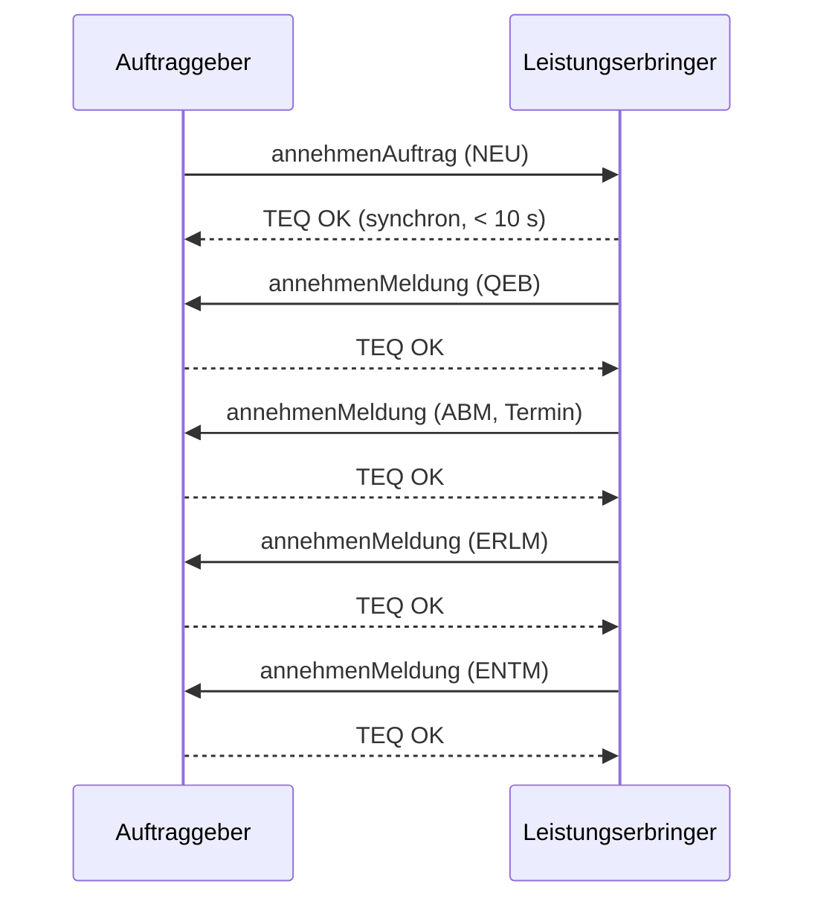
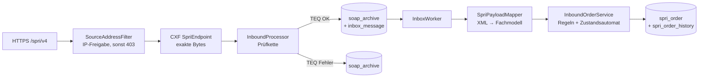
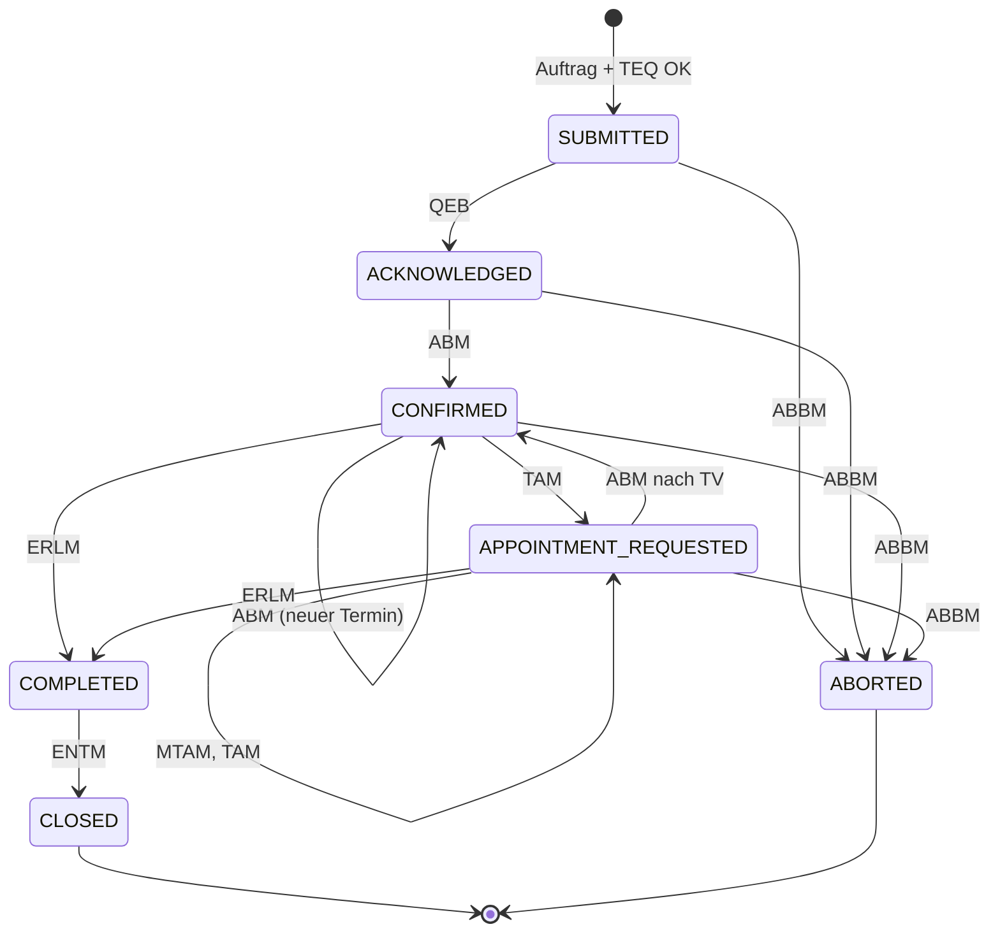

# S/PRI für Entwickler

Diese Einführung erklärt, wie S/PRI funktioniert und wo das im Code von open-spri steckt. Normativ sind immer die Dokumente des AK S&P (`./scripts/fetch-spec.sh`), insbesondere die Schnittstellenbeschreibung V4.4. Begriffe stehen im [Glossar](glossar.md).

## 1. Worum es geht

S/PRI ist die Bestellschnittstelle zwischen Telekommunikationsanbietern für Vorleistungsprodukte (FTTH, FTTB, FTTC, Bitstream):

- Der **Auftraggeber (AG)** bestellt beim **Leistungserbringer (LE)**, zum Beispiel einen FTTH-Anschluss für einen Endkunden.
- Der LE meldet den Fortschritt zurück: angenommen, Termin bestätigt, erledigt, abgerechnet.
- Beim **Providerwechsel (PV)** kommt der **abgebende Endkundenprovider (EKPab)** hinzu. Er wird informiert und stimmt zu.

open-spri kann **alle drei Rollen**, auch gleichzeitig gegenüber verschiedenen Partnern.

## 2. Technik in einem Satz

SOAP 1.1 über HTTPS, jede Nachricht mit WS-Security signiert. Es gibt **genau zwei Operationen**: `annehmenAuftrag` und `annehmenMeldung`. Jede Seite ist zugleich Server und Client. Jede Nachricht wird synchron mit einer **technischen Quittung (TEQ)** beantwortet, die fachliche Antwort folgt später als eigene Nachricht.

## 3. Der Weg einer eingehenden Nachricht durch open-spri

| Schritt | Code | Spezifikation |
|---|---|---|
| IP-Freigabe | `soap/config/SourceAddressFilter` | Security-Dokument 2.6 |
| Signatur | `soap/WsSecurity` (`WsSecurityVerifier`) | 10, Security-Dokument 2.5 |
| XSD | `soap/SpriSchema` | 10.3, Anlage 3 |
| Version | `domain/InterfaceVersion` | 10.4 |
| Anlage-1-Attribute | `rules/AttributeValidator` | 10.4 (4)/(5), Anlage 1 |
| TEQ | `soap/TeqResponder`, `domain/exchange/TeqCode` | 8.1, 11.2.3 |
| Archiv | `persistence/JdbcMessageArchive` | NF-09 |
| Fachliche Verarbeitung | `domain/order/InboundOrderService` | 5–8 |

## 4. Geschäftsfälle

| Code | Geschäftsfall | Änderungskennzeichen | Besonderheit |
|---|---|---|---|
| NEU | Bereitstellung | Standard, Storno, TV | Konnektivitätsauftrag: erst Ausbau, dann TAM 6022, dann TV mit echtem Termin |
| KUE-AG | Kündigung durch AG | Standard, Storno, TV | |
| KUE-LE | Kündigung durch LE | Standard | beginnt mit der Meldung KDLE, nicht mit einem Auftrag |
| AEN-LMAE | Leistungsmerkmaländerung | Standard, Storno | |
| LAE | Leistungsänderung | Standard, Storno, TV | |
| PV | Providerwechsel | Standard, Storno, TV | zusätzlich AKM-PV … ENTM-PV mit dem EKPab |
| EST | Entstörung (optional) | Standard, Storno, Reklamation | TAM/TBK für Termine beim Kunden |
| DIAG-GET/SET | Diagnose (optional) | – | nur ERLM oder ABBM. In Meldungen heißt der Geschäftsfall `GET`/`SET`. |

Storno und Terminverschiebung (TV) haben **dieselbe externe Auftragsnummer** wie der ursprüngliche Auftrag. Die Antworten darauf erkennt man am **Änderungskennzeichen** in der Meldung.

## 5. Der Zustandsautomat

`domain/order/OrderLifecycle` gilt für **beide Rollen**:
- **Als AG** verfolgen wir damit die Meldungen des Partners. Das läuft tolerant: Unpassende Meldungen werden vermerkt, aber nicht abgewiesen.
- **Als LE** prüfen wir damit unsere eigenen Meldungen vor dem Senden. Das läuft streng.

Dazu kommen:
- **Anfragen des AG** (`RequestKind`): Storno, Terminverschiebung, Reklamation. Pro Art ist höchstens eine gleichzeitig offen (R-03).
- **Ein angenommener Storno** (ERLM 0012) beendet den Auftrag ohne eigene Erledigung, danach folgt nur noch die ENTM (R-04). Ein abgelehnter Storno (ABBM) lässt den Auftrag weiterlaufen.
- **Der PV-Kanal** zum EKPab (`HandoverPhase`): AKM-PV → RUEM-PV → ABM-PV → ERLM-PV → ENTM-PV, oder ABBM-PV.

**Prüfung gegen die Testfallliste:** `KftSequenceReplayTest` spielt alle 211 Meldungsfolgen der offiziellen KFT-Testfallliste durch den Automaten. Wer den Automaten ändert, sieht sofort, welcher Testfall bricht.

## 6. Regeln und wo sie stehen

| Regel | Inhalt | Code |
|---|---|---|
| 7.2 | zulässige Meldungen je Geschäftsfall | `OrderLifecycle.ALLOWED` |
| R-02 | TV braucht einen anderen Termin (außer bei automatischer Anschlussidentifikation) | `OrderRules.check` |
| R-03 | je ein offener Storno und eine offene TV | `OrderLifecycle.request` |
| R-04 | Storno beendet ohne Erledigung | `OrderLifecycle.answerToStorno` |
| R-05 | Termin < 180 Tage in der Zukunft | `OrderRules.check` |
| R-10 | kein zweiter offener Auftrag am selben Anschluss | `InboundOrderService` + `infrastructureKey` |
| R-12 | Kopplungskenner nur mit Projektkenner, Klammer ≤ 20, keine Kündigung in der Klammer | `OrderRules.check` |
| R-13 | Meldungscode existiert und passt zu Meldungstyp und GF | `MessageCodeCatalog.check` |
| R-15 | LineID `LLL.CCCCCC.NNNNNNNNNN` | `OrderRules.isValidLineId` |
| 11.4 | Dublette → ABBM 1010 | `InboundOrderService.receiveOrder` |
| Anlage 1 | Pflicht- und unzulässige Felder je GF/Produktgruppe bzw. Meldungstyp | Modul `spri-rules` |

## 7. Wo die Spezifikation Lücken hat

Jede Auslegung steht mit Quelle in [`docs/spec-abweichungen.md`](../spec-abweichungen.md). Wer eine neue Lücke findet, trägt sie dort ein, bevor Code dazu entsteht.
