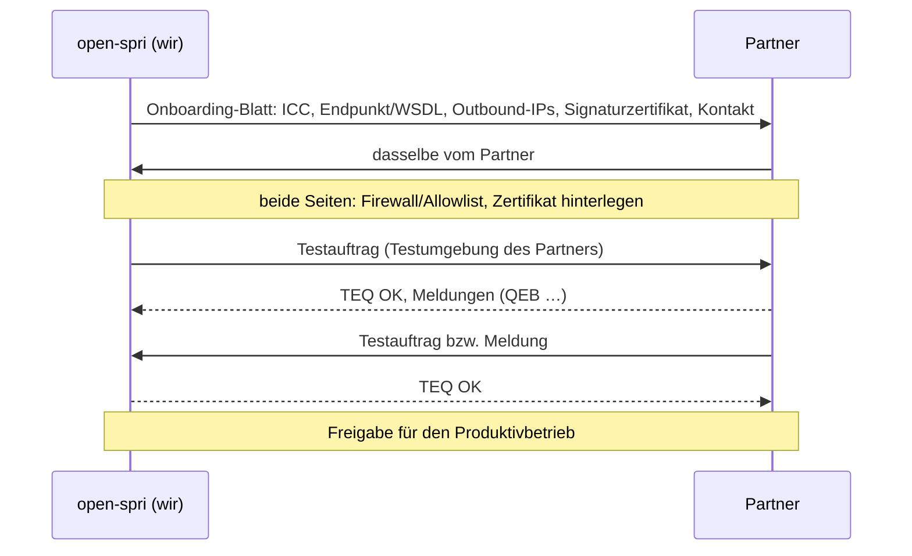

# Partner anbinden

Diese Anleitung beschreibt, wie ein neuer S/PRI-Partner an open-spri angebunden wird, in beiden Richtungen. Die Grundlage sind das AK-Sicherheitsdokument V3.0 (Kap. 2.4 bis 2.6) und die Spezifikation V4.4 (Kap. 3.3, 11). Die REST-Aufrufe stehen in [api/partner.md](api/partner.md), der Betrieb in [betrieb.md](betrieb.md).

## Überblick



## 1. Voraussetzungen bei uns

Vor dem ersten Partner muss Folgendes erledigt sein:

- [ ] Setup abgeschlossen, mit Firmendaten, **ITU Carrier Code** und Rollen (Auftraggeber und/oder Leistungserbringer)
- [ ] öffentlicher **S/PRI-Endpunkt** in den Einstellungen eingetragen, z. B. `https://spri.example.de/spri/v4`
- [ ] **TLS-Zertifikat** einer CA von der AK-Whitelist (Let's Encrypt ist zugelassen). Der Selbsttest *TLS* ist grün ([betrieb.md](betrieb.md#selbsttests)).
- [ ] **Signaturschlüssel** dauerhaft gespeichert (Setup-Assistent oder Keystore-Datei), RSA ≥ 3072 Bit, nicht der vorläufige Schlüssel
- [ ] **Outbound-IP(s)** fest eingerichtet und in den Einstellungen eingetragen. Der Selbsttest *Outbound-IP* ist grün ([betrieb.md](betrieb.md#ausgehende-adresse-outbound-ip)).
- [ ] **Meldungscodetabelle** importiert. Ohne sie sendet open-spri keine Meldungen.
- [ ] Mailserver und `OPENSPRI_NOTIFICATIONS_OPERATOR_EMAIL` gesetzt, damit Ausfall-Mails ankommen

## 2. Daten austauschen

**Was der Partner von uns bekommt:** das Onboarding-Blatt, in der Oberfläche unter *Partner → Unsere Angaben für Partner* oder per REST:

```bash
curl -s $SPRI/api/v1/partners/onboarding-sheet -H "Authorization: Bearer $TOKEN"
curl -s $SPRI/api/v1/partners/wsdl -H "Authorization: Bearer $TOKEN" -o open-spri.wsdl
```

| Angabe | Wozu der Partner sie braucht |
|---|---|
| ITU Carrier Code, Firmenname | Zuordnung, Rahmenvertrag |
| S/PRI-Endpunkt und WSDL | Ziel seiner Aufträge bzw. Meldungen. Die WSDL ist die AK-WSDL mit unserem Endpunkt (Spezifikation 3.3). |
| **Outbound-IPs** | Er schaltet sie an seiner Firewall frei (Sicherheitsdokument 2.6). |
| **Signaturzertifikat** (PEM) | Er prüft damit unsere WS-Security-Signatur. |
| technischer Kontakt | Störungen, Wartungsankündigungen |
| unsere Inbound-IP (nur auf Nachfrage) | für Partner, die ihren ausgehenden Verkehr beschränken |

**Was wir vom Partner brauchen:**

| Angabe | Wo sie eingetragen wird |
|---|---|
| Name, ITU Carrier Code | Partner anlegen |
| S/PRI-Endpunkt (aus seiner WSDL) | Feld *S/PRI-Endpunkt* |
| **seine Outbound-IPs** (IPv4/IPv6, CIDR) | *IP-Freigaben*. Nur diese Adressen erreichen unseren Endpunkt. |
| **sein Signaturzertifikat** (X.509 v3, RSA ≥ 3072, SHA256withRSA) | *Zertifikate* |
| technischer Kontakt (E-Mail) | erhält die Ausfall-Mail (11.2.3.2) |
| Rahmenvertrag: Auftraggeber- und Leistungsnummern | *Verträge und Vollmachten* |
| ggf. Vollmachten (Bestellung im Namen Dritter), Projektkenner | *Verträge und Vollmachten* |
| ggf. Produktbezeichner und Wechselmatrix | *Produkte* |
| ggf. Replikat- bzw. Online-Abfrage-Zugang | *Verfügbarkeit verwalten → Quellen der Partner* ([api/verfuegbarkeit.md](api/verfuegbarkeit.md)) |

Zertifikate und IP-Adressen nur über einen vertrauenswürdigen Kanal entgegennehmen und den Fingerabdruck telefonisch abgleichen:
```bash
openssl x509 -in partner.pem -noout -fingerprint -sha256 -subject -enddate -text | grep -E "Fingerprint|Subject:|Not After|Public-Key"
```

## 3. Partner anlegen

In der Oberfläche unter *Partner → Partner anlegen*, oder:

```bash
curl -s -X POST $SPRI/api/v1/partners -H "Authorization: Bearer $TOKEN" -H "Content-Type: application/json" -d '{
  "name": "Glasfaser Nord GmbH", "carrierCode": "GFNORD",
  "endpointUrl": "https://spri.partner.example/spri/v4", "technicalContactEmail": "spri-betrieb@partner.example",
  "allowedSourceNetworks": ["198.51.100.0/28"],
  "certificatesPem": ["-----BEGIN CERTIFICATE-----\n…\n-----END CERTIFICATE-----\n"]
}'
```

Danach auf der Partnerseite unter *Verträge und Vollmachten* den Rahmenvertrag und, falls nötig, Vollmachten und Projekte hinterlegen, außerdem die Produkte. Läuft unser Verkehr über einen Egress-Proxy, den dieser Partner nicht freigeschaltet hat, unter *Stammdaten* den Schalter *Über den Egress-Proxy senden* abschalten.

**Optional zusätzlich im Proxy:** die IPs des Partners in `deploy/nginx/snippets/openspri-spri-allowlist.conf` eintragen ([betrieb.md](betrieb.md#zusätzliche-ip-sperre-für-den-spri-endpunkt)).

## 4. Verbindung testen

S/PRI kennt keinen Ping. Die Verbindung wird mit echten Nachrichten geprüft, möglichst zuerst gegen die Testumgebung des Partners:

1. **Netz:** Von unserem Host aus `curl -sv https://spri.partner.example/spri/v4?wsdl -o /dev/null` aufrufen. Erwartet wird ein erfolgreicher TLS-Handshake. Ein 403 oder ein Timeout deutet auf eine fehlende Freischaltung unserer Outbound-IP hin.
2. **Wir → Partner:** einen Testauftrag als Entwurf anlegen und senden, oder eine Meldung als Leistungserbringer. Im *Zustellmonitor* muss der Eintrag `DELIVERED` erreichen (TEQ OK):

   | Ergebnis | Ursache |
   |---|---|
   | `UNDELIVERABLE` bzw. Wiederholungen mit „Verbindung abgelehnt“ | Endpunkt falsch, Firewall des Partners, Outbound-IP nicht freigeschaltet |
   | TEQ 0999 | Der Partner kann unsere Signatur nicht prüfen. Hat er unser aktuelles Zertifikat? |
   | TEQ 0995 | Inhalt oder XSD; Befund im Archiv |
   | `UNCLEAR` | keine TEQ innerhalb der Wartezeit; mit dem Partner klären (NF-05) |
3. **Partner → wir:** Der Partner sendet einen Testauftrag bzw. eine Meldung. Sie erscheint unter *Zustellmonitor → Eingang* und im Archiv mit TEQ `OK`:

   | Ergebnis beim Partner | Ursache |
   |---|---|
   | HTTP 403 | Seine Absender-IP fehlt in den *IP-Freigaben* (`openspri_inbound_requests_seconds{teq="forbidden"}` steigt). |
   | TEQ 0999 | Sein Signaturzertifikat fehlt bei uns, oder `signaturId` passt nicht zum Zertifikat (SA-005). |
   | TEQ 0995 | XSD- oder Strukturfehler; der Grund steht intern im Archiv (`rejectionReason`). |
   | TEQ 0993 | falsche Version (Major-Release ≠ 4) |
4. Optional einen vollständigen Ablauf mit dem Partner durchspielen, etwa NEU bis ENTM, inklusive Terminverschiebung und Storno.

## 5. Produktivbetrieb

- [ ] Testaufträge abgeschlossen bzw. storniert, keine offenen Einträge im Zustellmonitor
- [ ] Produktiv-Endpunkt und -Zertifikat des Partners eingetragen, falls sie von der Testumgebung abweichen
- [ ] Alarme für den Partner aktiv ([betrieb.md](betrieb.md#überwachung))
- [ ] Ansprechpartner und Eskalationsweg auf beiden Seiten bekannt
- [ ] Bei Bedarf Replikat-Freigabe bzw. Partner-Token für die Online-Abfrage erstellt (Rolle `PARTNER`)

## 6. Im laufenden Betrieb

| Ereignis | Vorgehen |
|---|---|
| Partner tauscht sein Signaturzertifikat | neues zusätzlich hinterlegen, nach seiner Umstellung das alte entfernen |
| Wir tauschen unseren Signaturschlüssel | Ablauf in [betrieb.md](betrieb.md#zertifikatswechsel), alle Partner mit Vorlauf informieren |
| Partner ändert seine Outbound-IPs | *IP-Freigaben* rechtzeitig ergänzen, alte erst nach der Umstellung entfernen |
| Unsere Outbound-IP ändert sich | alle Partner mit Vorlauf informieren (*Wartung ankündigen*), neue IP eintragen, Selbsttest |
| Partner nicht erreichbar | open-spri wiederholt und schickt höchstens eine Mail pro Tag und Ausfall (11.2.3.2); danach erneut senden oder über den E-Mail-Kanal übermitteln |
| Wartung bei uns | 5 Werktage vorher ankündigen (11.5) |
| Partnerschaft endet | Partner deaktivieren (*Partner aktiv* aus). Seine Aufträge und das Archiv bleiben erhalten. |
